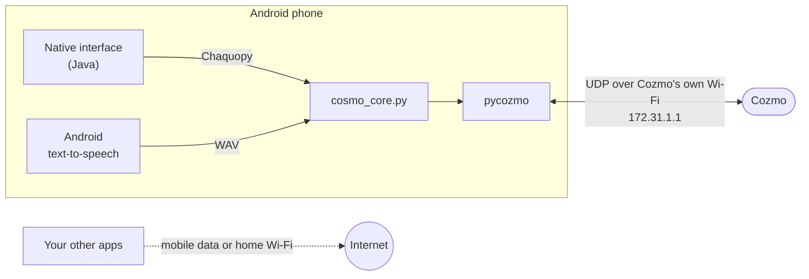
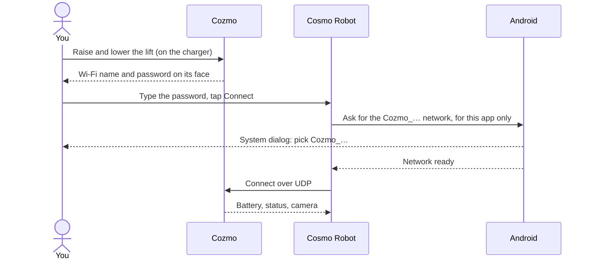

<p align="center"></p>

# Cosmo Robot

[](LICENSE)
[](#compatibility)
[](#compatibility)
[](#privacy)
[](#privacy)
[](#install)

A second chance for Anki Cozmo robots: drive yours from an Android phone,
without the official app.

No account, no cloud, no telemetry. Cosmo Robot joins the robot's own Wi-Fi and
talks to it directly: joystick, camera, voice, screen and lights. The robot side is [pycozmo](https://github.com/zayfod/pycozmo), the
open-source Python implementation of Cozmo's protocol, running inside the app
through [Chaquopy](https://chaquo.com/chaquopy/). The interface is native
Android, in Java.

<!-- screenshot: main screen, camera view with the joystick -->

## Why

Anki closed in 2019, and the robots outlived the company. If the official app no
longer installs on your phone, no longer finds your robot, or asks for an
account you would rather not create, Cosmo Robot is an alternative. It depends
on no server at all: the only things involved are your phone and your Cozmo.

## What it does

Version 0.1 is in development. No build is published yet.

- **Connect from the app.** Type the Wi-Fi password Cozmo shows on its face:
  on Android 10 and later, the app joins the robot's network by itself, and the
  phone keeps its internet connection for your other apps.
- **Drive.** Analogue joystick with a dead-man stop: if the app freezes or your
  finger slides off the screen, the robot stops within 0.35 seconds.
- **Head, lift, speed, volume.** Set the head angle, the lift height, the
  driving speed and the robot's speaker volume.
- **Live camera.** Cozmo's camera on your screen.
- **Speech.** Type a sentence and Cozmo says it through its own speaker. The
  voice is your phone's text-to-speech, so any language your phone has a voice
  for works; it follows Android's text-to-speech settings.
- **Screen.** Show your own text on Cozmo's OLED face.
- **Backpack lights.** Pick their colour.
- **Robot status.** Battery level, on the charger, charging, picked up, edge
  detected.
- **Automatic reconnection.** If the robot reboots, which a worn battery makes
  frequent, the app reconnects and puts the head, lift and lights back where
  they were.

<!-- screenshot: connection screen -->
<!-- screenshot: speech and screen controls -->

## How it works

Everything runs on the phone. The app joins the robot's Wi-Fi for itself only,
so your other apps keep using mobile data or your home Wi-Fi.



## Connect your robot

1. Put Cozmo on its charger, plugged into USB power.
2. Raise its lift by hand and lower it again: the screen shows the network name
   (`Cozmo_XXXXXX`) and the password.
3. Open Cosmo Robot, type the password and tap **Connect**.
4. On Android 10 and later, Android shows its own dialog: pick the `Cozmo_…`
   network. On Android 8 and 9, join the `Cozmo_…` network in the Wi-Fi settings
   first, then come back and tap **Connect**.
5. Take Cozmo off the charger to drive: it does not move while docked.

What happens when you tap **Connect** on Android 10 and later:



The full guide, with troubleshooting, is in
[docs/connecting.md](docs/connecting.md).

## Install

Cosmo Robot will be published on Google Play (coming soon). Until then, build
it from source, as described below.

## Compatibility

- **Android 8.0 (API 26) or later.** Joining the robot's Wi-Fi from inside the
  app needs Android 10; on Android 8 and 9 you join it in the system settings.
- **64-bit ARM phones (`arm64-v8a`).** 32-bit phones and x86 emulators are not
  supported: each extra architecture would add a full copy of Python and NumPy
  to the download.
- **Anki Cozmo** (the original robot, not Vector). Developed against a robot on
  firmware 2380.

## Privacy

- **No data leaves your phone, except to your robot.** The app talks to Cozmo
  over UDP on the robot's own network (`172.31.1.1`) and to nothing else.
- **No account, no analytics, no crash reporter, no ads.**
- **Permissions:** network and Wi-Fi state, to find and join the robot's
  network, and Internet, which Android requires for any socket, including the
  local link to the robot. No location, no microphone, no storage.
- **Speech** goes through Android's standard text-to-speech interface, to the
  engine already installed on your phone. Cosmo Robot sends the text nowhere
  else.
- **The camera feed** is displayed, not recorded.
- **Android backup is disabled**, so the app's settings are not copied to a
  cloud backup.

## Build from source

Requirements:

- Android Studio, or JDK 17 with the Android SDK (compile SDK 35).
- **Python 3.12** on the build machine, as `python3.12` on the `PATH`.
  Chaquopy needs the build Python to match the embedded one, and the embedded
  one is 3.12 because pycozmo 0.8.0 imports the `chunk` module, removed in
  Python 3.13. Another location can be given with
  `-PbuildPython=/path/to/python3.12`.

```bash
git clone https://github.com/LabbeSimon/Cosmo-robot.git
cd Cosmo-robot
./gradlew assembleDebug      # app/build/outputs/apk/debug/app-debug.apk
./gradlew assembleRelease    # unsigned unless you add your own signing config
adb install app/build/outputs/apk/debug/app-debug.apk
```

The build downloads pycozmo and its dependencies through Chaquopy. That is the
only network access involved, and it happens at build time, not in the app.

## Roadmap

Planned, not yet in the app:

- **Original animations.** Anki's animations, downloaded on first launch from
  their own source, never included in the app or in this repository.
- **Face tracking.**
- **Cubes.**
- **Hand gestures.**
- **Surveillance mode.**

These already work on a server in the sibling project,
[Cozmo for Home Assistant](https://github.com/LabbeSimon/Cozmo_HomeAssistant),
and are to be brought to the phone.

## FAQ

### The Cozmo app is not working. Can I still use my robot?

Yes. The robot does not need the official app or any server to be driven:
everything it needs is its charger and a phone on its Wi-Fi. Cosmo Robot covers
driving, camera, speech, screen and lights today; see the roadmap for the rest.

### How do I control Cozmo without the official app?

Put the robot on its charger, raise and lower its lift to show its Wi-Fi
password, and connect with Cosmo Robot. Details in
[docs/connecting.md](docs/connecting.md). On a computer rather than a phone,
pycozmo itself, or the Home Assistant project above, does the same job.

### Is there a Cozmo app alternative for Android?

That is what this project is: an open-source Android app for Anki Cozmo robots,
with no account and no cloud.

### Does it work with Vector?

No. Vector is a different robot with a different protocol. pycozmo, and
therefore this app, only speaks to Cozmo.

### Does it work on iPhone?

No, Android only.

### Does it need an internet connection or an account?

No. Internet is only needed to download the app. On Android 10 and later, your
phone keeps its usual internet connection while connected to the robot.

### Why is it called Cosmo Robot?

To keep a name of its own: Cozmo is a trademark of Digital Dream Labs. The app
is made for Anki Cozmo robots and is not an official product.

## Related project

[Cozmo for Home Assistant](https://github.com/LabbeSimon/Cozmo_HomeAssistant),
by the same author: Cozmo as a fully local Home Assistant device, with face
tracking, cube detection, hand gestures, surveillance and recording.

## Credits

- [pycozmo](https://github.com/zayfod/pycozmo) by Kaloyan Tenchov (MIT), which
  does all the talking to the robot.
- [Chaquopy](https://github.com/chaquo/chaquopy) by Chaquo Ltd (MIT), which runs
  Python inside an Android app.

The full list of third-party components and their licences is in
[THIRD_PARTY.md](THIRD_PARTY.md). Contributions are welcome, see
[CONTRIBUTING.md](CONTRIBUTING.md).

## About this documentation

This README and the pages under `docs/` were written with the help of an AI
assistant, from the code and from what the Home Assistant project measured on a
real robot. Correct anything that does not match what you see on your own.

## Licence

European Union Public Licence v1.2 (EUPL-1.2), see [LICENSE](LICENSE). Every language version of the EUPL is equally valid: [official texts](https://interoperable-europe.ec.europa.eu/collection/eupl/eupl-text-eupl-12).

Not affiliated with, endorsed by or sponsored by Digital Dream Labs or Anki.
Cozmo is a trademark of Digital Dream Labs. Cosmo Robot uses no Anki code: it
talks to the robot over the protocol pycozmo implements.
